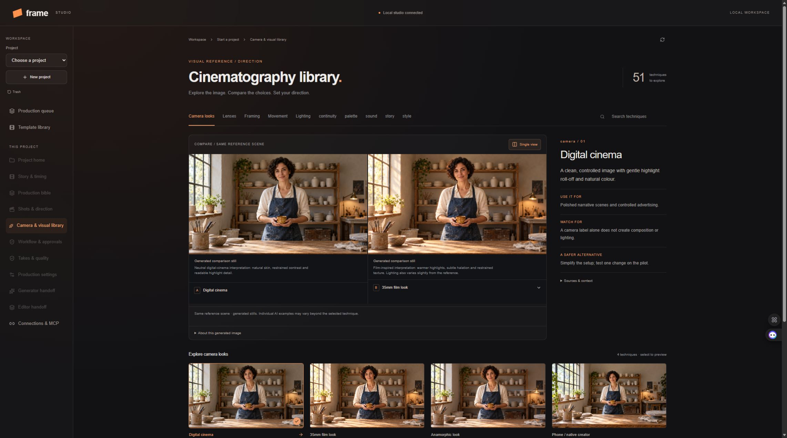
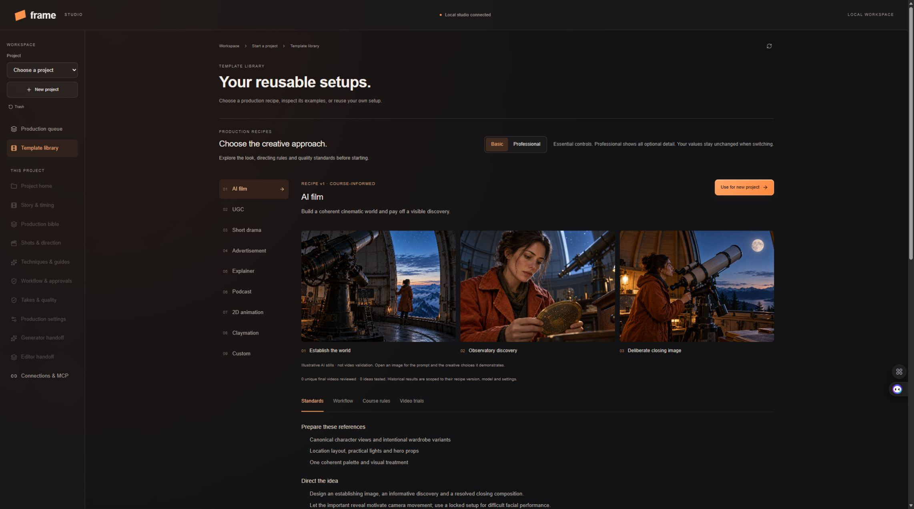
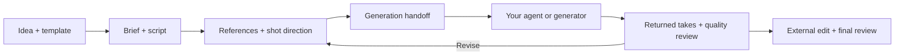

# Orchestra

Formerly Frame Studio. Orchestra keeps existing projects, MCP identifiers and application-data paths compatible.

**An idea-to-production workspace for creators and their AI agents.**

Plan the story, choose the visual direction, generate through your own tools, and review each result in one local studio. Frame keeps the workflow, creative decisions, references and quality checks together so a successful approach can be reused.

[Download Orchestra 0.3.1 for Windows](https://github.com/xraider26/frame-studio/releases/tag/v0.3.1) · [Release notes](docs/releases/v0.3.1.md) · [First project](docs/GETTING-STARTED.md) · [Agent / MCP guide](docs/MCP.md) · [Windows setup](docs/WINDOWS.md)

**0.3.1** fixes MCP discovery and authentication when Windows gives Codex a different AppData view from the running desktop. The desktop Copy MCP configuration menu now offers Codex TOML and Cursor, Claude Desktop and Antigravity JSON using the actual installed executable. Existing image/video projects, generator setup, calibration and compact agent handoffs are retained.

The workspace separates **Image / Video templates**, includes seven image formats and seven editable video sequence patterns, and organizes tools into **Brief → Plan → Create → Review → Export**. See [templates and navigation](docs/TEMPLATES-AND-SEQUENCES.md).

Explicit image editing/text/layout requirements, Qwen-Image 2.1 guidance and direct execution of mapped ComfyUI image/video workflows are included. [ComfyUI setup and limits](docs/COMFYUI.md). The older Frame Studio release remains available in the release history.

### Calibrate before production

The connected AI asks which image/video generators you will use once per project, then asks again only when relevant choices change. Generate one representative still, inspect its technical quality, and let the creator accept or reject the visual treatment before more images proceed. Agent inspection never grants creator approval. Existing projects retain their saved policies until explicitly adopted.

Each take can show applicable course-rule bindings, the exact compiled/submitted prompt and reference versions, and whether execution evidence was server-recorded or agent-reported. Compact schema-3 claims and summary polling reduce repeated context; a synthetic fixture measured 301,679 → 11,920 bytes (96.05% fewer bytes, not a measured billing reduction). [Calibration and verification scope](docs/CALIBRATION-TRIAL.md).

> **Early Windows x64 beta.** The installer is unsigned and has been tested on one Windows 11 machine, including installation into a different folder. Generation tools/accounts are supplied by you. The goal is repeatable, high-quality production; consistent artistic results still need real production trials.



*Earlier Frame Studio beta interface; next-beta navigation has changed. The photographic studies are generated teaching examples, not camera test footage or guarantees of model output.*

## What is Orchestra?

Orchestra is a production workflow and creative-direction tool for people making AI-assisted videos. Work in the interface, connect an MCP-capable agent, or export a generator-specific handoff for another tool.

The studio organizes the work from brief to final review. Your agent writes and executes through its available tools; Frame provides project state, instructions, references, the next action and approval requirements. Returned media becomes inspectable takes linked to the original brief.

It is useful for independent creators, filmmakers exploring AI, small content teams and people developing repeatable formats. Planning and review do not require the original developer's hardware or folder layout. Any generation tool you use has its own requirements and costs.

## See the choice before applying it

The **Camera & visual library** is a central part of the studio:

- **26 generated still studies:** four camera looks, five lens/depth studies, seven framing/angle studies and ten lighting setups.
- **Eight interactive camera movements:** locked, dolly in/out, tracking, pan, tilt, orbit and handheld, with playback, scrubbing and a camera-path view.
- **Side-by-side comparison:** related choices from a shared reference scene, with explanations of when each helps and what can go wrong.
- **Explicit application:** preview changed fields, then apply a technique to a shot or shared defaults. Existing shot overrides remain effective.
- **Inline (?) help:** the same examples beside the shot controls.

Movement studies are procedural spatial demonstrations. Stills are approximate AI illustrations; lens/camera names are direction cues rather than calibrated equipment simulations. [Cinematography details](docs/CINEMATOGRAPHY.md).

## Start with a format, keep your own vision

Choose **AI film, UGC, short drama, advertisement, explainer, podcast, 2D animation, claymation or custom content**. Each recipe has three illustrative images and guidance for references, story roles, camera/light choices, sound, acceptance checks and focused repairs.

Save workflows, creative settings and optional shot plans as your own templates. Basic and Professional views reveal different amounts of detail while using the same underlying standards.



*Recipes provide editable production structure. These illustrative stills are not validated finished-video templates.*

Recipes adapt a supplied course review and selected original lesson pages into practical rules. Source links, page references and studio corrections are tracked separately. **Ten PDFs were recovered; 66 selected pages were verified.** This is not a complete import of every lesson or a replacement for the original course. Private original PDFs are not distributed. [Source scope](docs/COURSE-SOURCES.md) · [Recipe behavior](docs/COURSE-RECIPES.md).

## How production works



Enable human approval on the steps you want to check. An agent stops at those gates; automatic progression is available for permitted steps. Start with a representative pilot, inspect it, then continue production.

| Workflow | What you control |
| --- | --- |
| Story | Audience, promise, hook/payoff, timed beats, dialogue and captions |
| Visual direction | Camera look, lens cues, angle, composition, movement, lighting, palette and materials |
| Consistency | Character/location/prop references, wardrobes, scene states, eyelines and physical light sources |
| Quality | Required checks, take comparison, selected outputs, named defects and targeted revisions |
| Production | Reusable templates, idea batches, agent queue, attempt limits and recorded costs |
| Delivery | Generator prompt/reference ZIPs and selected clips with editor JSON/CSV timing and sound notes |

See [feature coverage](docs/CREATIVE-COVERAGE.md) and [batch production](docs/PRODUCTION-SCALE.md) for actual behavior and limits.

## Choose how to generate

| Route | How it works | What you need |
| --- | --- | --- |
| **Connected agent** | An agent reads the workflow through MCP, uses its authorized tools, then returns real media | An MCP-capable client and generation tools available to it |
| **External handoff** | Export prompts, references, shot IDs and settings for another tool or agent | Your generator and a way to return its files |
| **JSON Job API** | Studio submits to a configured adapter implementing its job contract | An adapter endpoint and any required provider credentials |

Configuration formats are provided for Codex, Cursor, Claude Code/Desktop and Antigravity. Exact setup and tool permissions vary; not every client/version has been independently tested. **A Flow/Runway prompt profile does not connect an account.** Vendor APIs need a compatible adapter. Frame does not ship a generation model or credits.

## Install the Windows beta

1. Open [the Windows beta release](https://github.com/xraider26/frame-studio/releases/tag/v0.2.0-beta.1).
2. Download `Frame-Studio-Setup-0.2.0.exe` and run setup. A SHA256 file is provided alongside it.
3. Launch **Orchestra** from its shortcut.
4. Open **Connections & MCP**, choose your client and copy the generated configuration if you want agent control.

The installer bundles Node.js, Python and FFmpeg/FFprobe. You do not need to clone the repository or install those runtimes separately. Paths are discovered on each machine. Keep the app open during agent use.

Projects and media stay in the current user's application-data folder, normally `%APPDATA%\Frame Studio\studio_data`. The app menu opens the actual location. No cloud media hosting is required; connected tools/providers may transmit data according to their own settings. [Install, data and build details](docs/WINDOWS.md).

## Current limits

- No automatic access to your Flow account or other generator accounts.
- No internal timeline editor or automatic final render in the connected studio; assemble the chosen clips in your preferred editing software.
- No automatic aesthetic judge, guaranteed continuity or guaranteed professional video quality. Recorded checks and human final-video assessments require actual inspection.
- No hosted team service, cloud project sync, signed installer or certified macOS/Linux desktop package in this release.

The beta passed actual installation, clean-PATH startup, bundled media tools, MCP stdio, shutdown and saved-project restart checks on the development machine. At the release commit, **119 backend tests, 42 UI tests and 10 desktop/build tests** passed. These establish software behavior; illustrative images are not artistic production trials.

## Develop from source

The published beta's implementation is tagged `v0.2.0-beta.1` and has been merged into `main` through [PR #1](https://github.com/xraider26/frame-studio/pull/1). Use the tag below for a reproducible beta checkout; `main` may include newer documentation or development changes.

On Windows, install Node.js **22.12+**, npm, Python 3.12 through `uv`, and FFmpeg/FFprobe for media imports:

```powershell
git clone --branch v0.2.0-beta.1 https://github.com/xraider26/frame-studio.git
Set-Location frame-studio
uv venv backend/.venv --python 3.12
uv pip install --python backend/.venv/Scripts/python.exe -r backend/requirements-studio.txt
Set-Location frontend
npm ci
npm run build
Set-Location ..
./launch-studio.ps1
```

Open **http://127.0.0.1:3000/studio**. The source workflow API uses port 8010. Desktop installations choose their own loopback ports. See [contributing and verification](CONTRIBUTING.md) for development branches and tests.

The older companion prototype at `/` and port 8000 is preserved separately. Its historical hardware/model assumptions are in [legacy notes](docs/LEGACY-COMPANION.md).

## Help and documentation

- [First project walkthrough and FAQ](docs/GETTING-STARTED.md)
- [Windows setup and troubleshooting](docs/WINDOWS.md)
- [MCP workflow and API adapter contract](docs/MCP.md)
- [Reviewed prompting guide and editable style setups](docs/PROMPTING-GUIDE.md)
- [Visual cinematography](docs/CINEMATOGRAPHY.md)
- [Recipes and final-video assessments](docs/COURSE-RECIPES.md)
- [Feature/source coverage](docs/CREATIVE-COVERAGE.md)
- [Report a reproducible issue](https://github.com/xraider26/frame-studio/issues/new)
- [Handle sensitive reports privately](SECURITY.md)

Include the app version, expected/actual behavior and a minimal reproduction. Review logs before sharing; do not post tokens, API keys, private databases or media you lack permission to share.

### Project and third-party status

This project is in early beta. No project-wide open-source license has been selected in this repository yet; public source visibility alone does not grant a reuse license. Bundled components retain their own licenses and notices; see [software notices](desktop/THIRD-PARTY-NOTICES.md). Orchestra is independent; third-party product names describe compatibility or workflow targets, not endorsement.
